# Borealis TV Launcher

**A light, beautiful home screen for Google TV and Android TV.** Your apps, your screensaver and "Continue watching",
in your language (Español, English, Português). Designed and developed by **Alogus Tov**.

**[⬇ Download the latest version](../../releases/latest)** · or on the TV open **Downloader** and type **3357424**

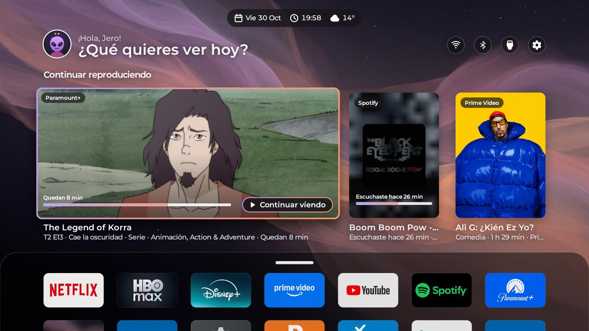

> Beta. Tested on Android TV 9, 11 and 14 (TCL, Sansui, Onn and others), see [Compatibility](#compatibility). Use it with care and tell me what you find.

<table>
  <tr>
    <td width="50%">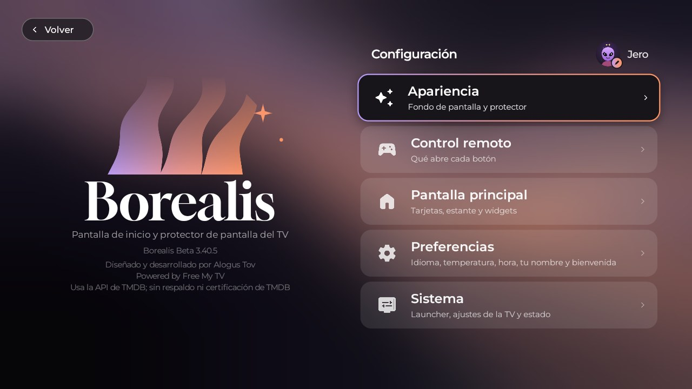 Settings</td>
    <td width="50%">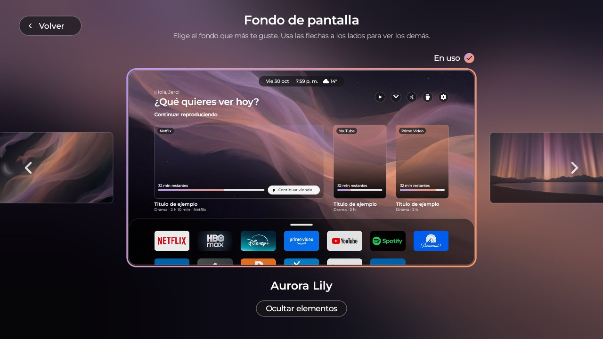 Wallpapers</td>
  </tr>
  <tr>
    <td width="50%">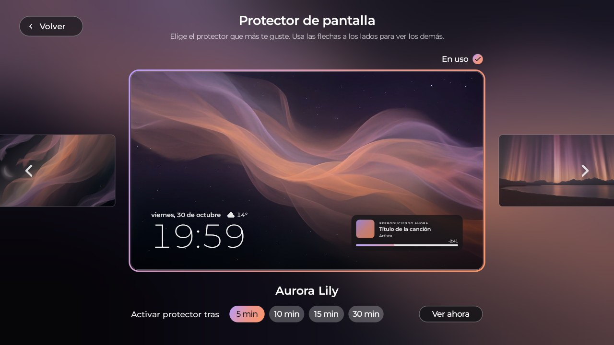 Screensaver</td>
    <td width="50%">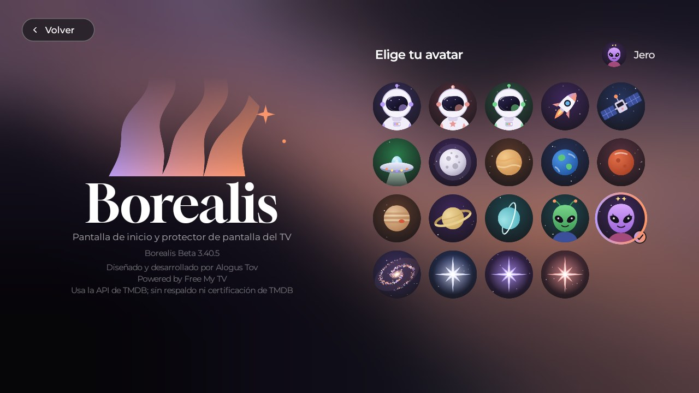 Pick your avatar</td>
  </tr>
</table>

## Your shelf
<table>
  <tr>
    <td width="50%">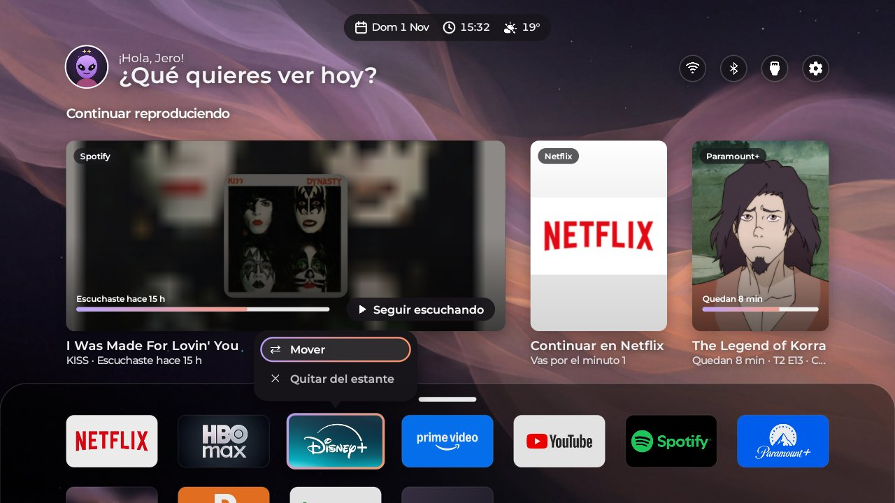 Hold OK: move or remove from the shelf</td>
    <td width="50%">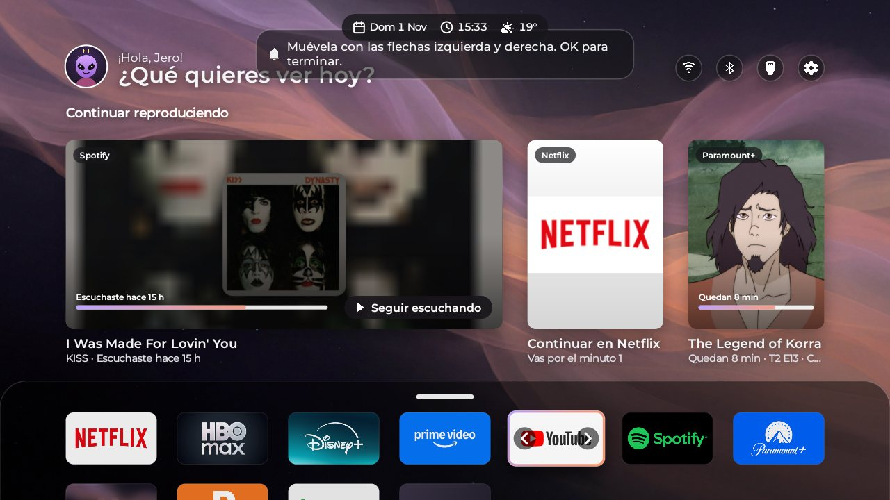 Move it with the arrows</td>
  </tr>
  <tr>
    <td width="50%">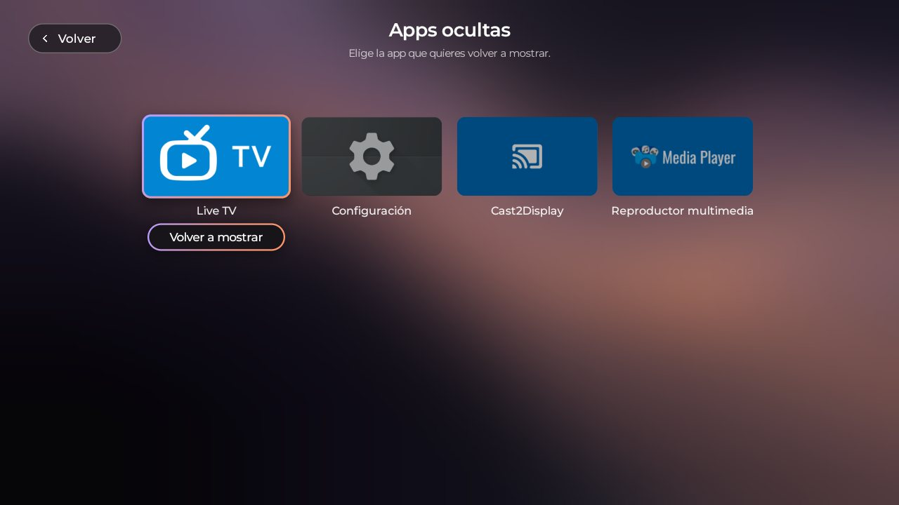 Hidden apps: bring them back any time</td>
    <td width="50%">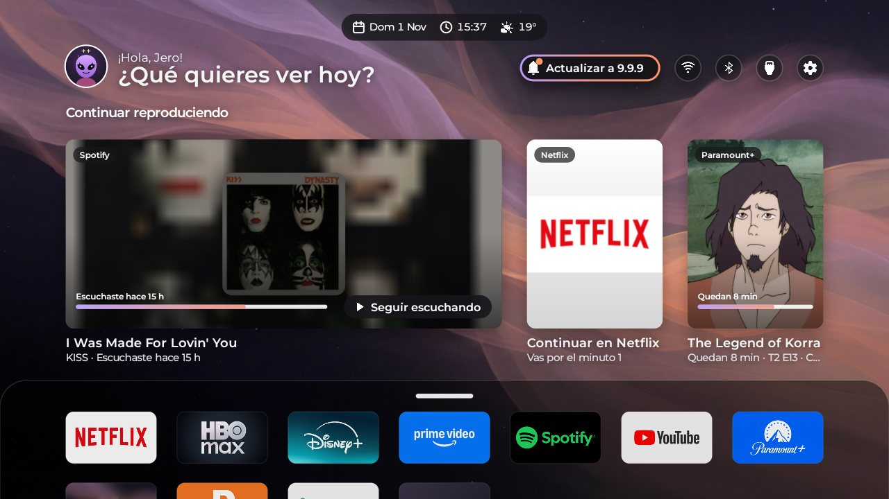 A bell tells you about updates</td>
  </tr>
</table>

## First run
A one-minute welcome sets up your language, your name, your home screen and "Continue watching". You can repeat it any time from Settings.

<table>
  <tr><td width="33%">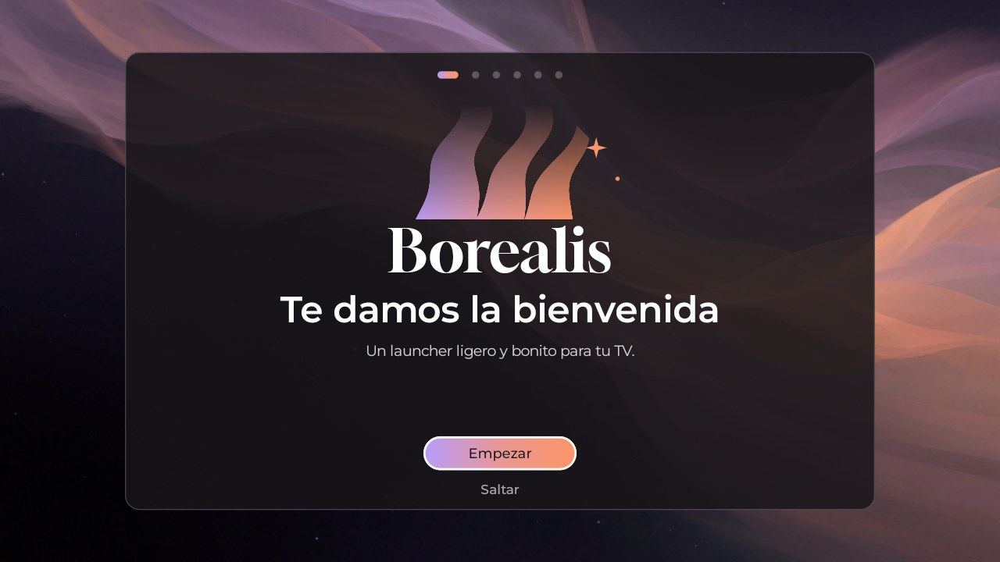 Welcome</td><td width="33%">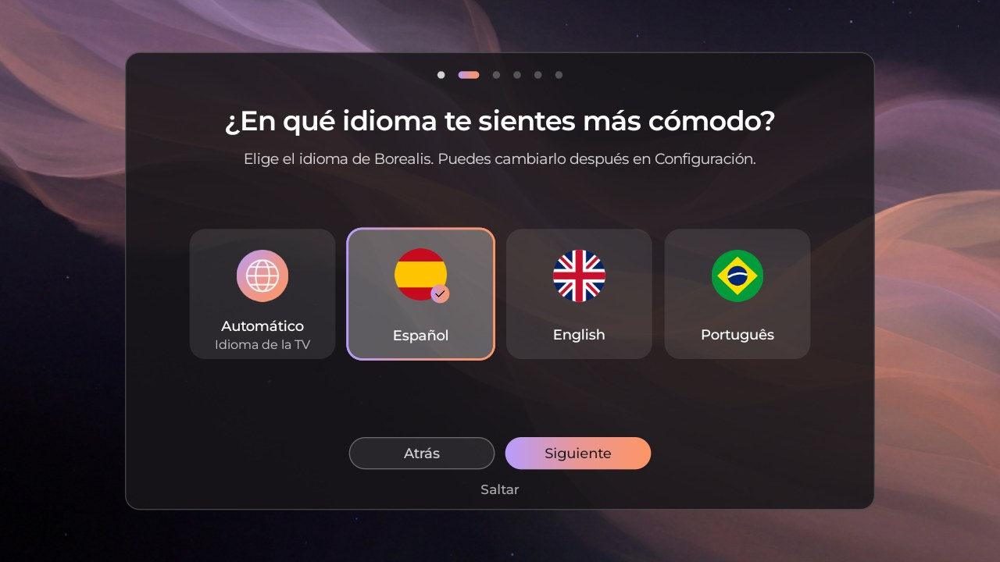 Language</td><td width="33%">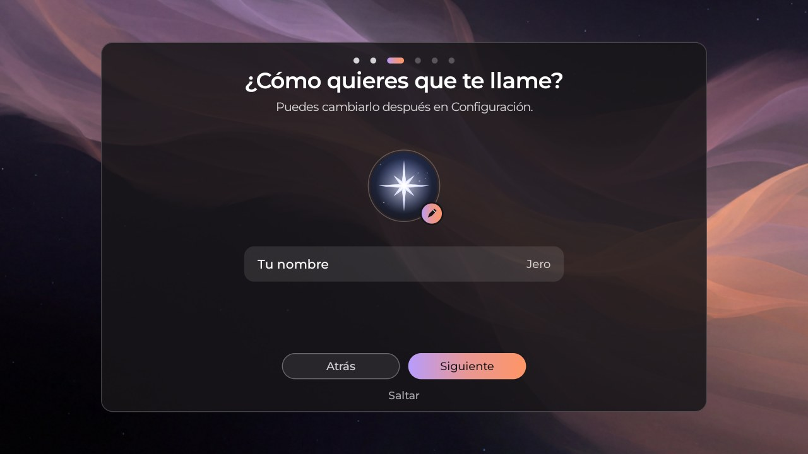 Your name</td></tr>
  <tr><td width="33%">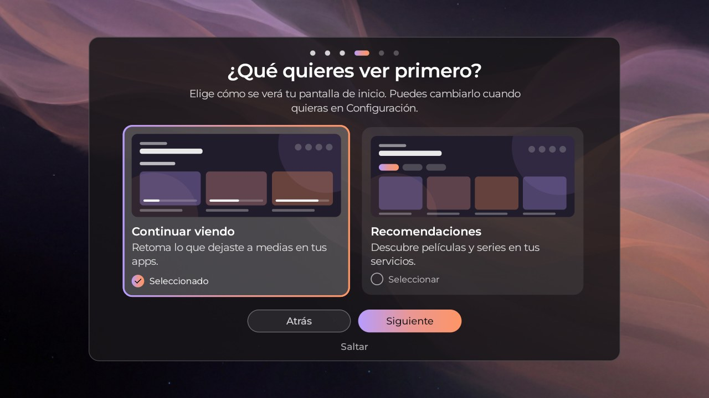 Your home screen</td><td width="33%">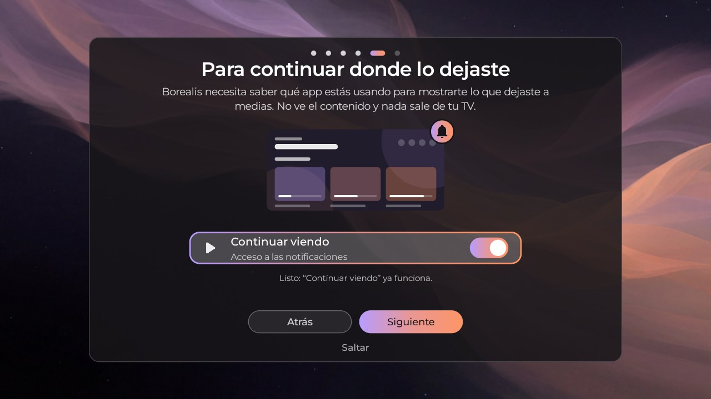 Continue watching</td><td width="33%">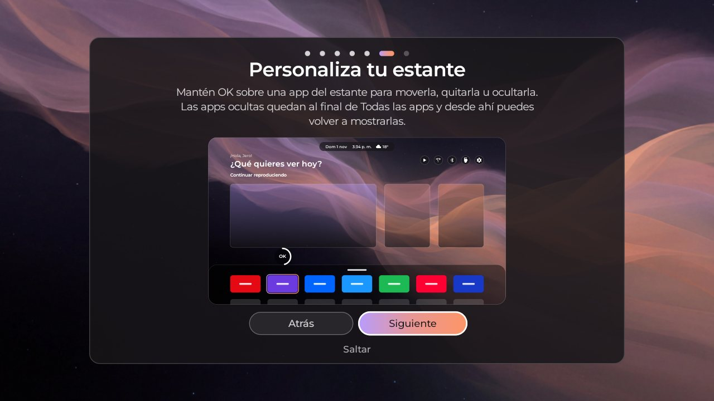 Customize your shelf</td></tr>
  <tr><td width="33%">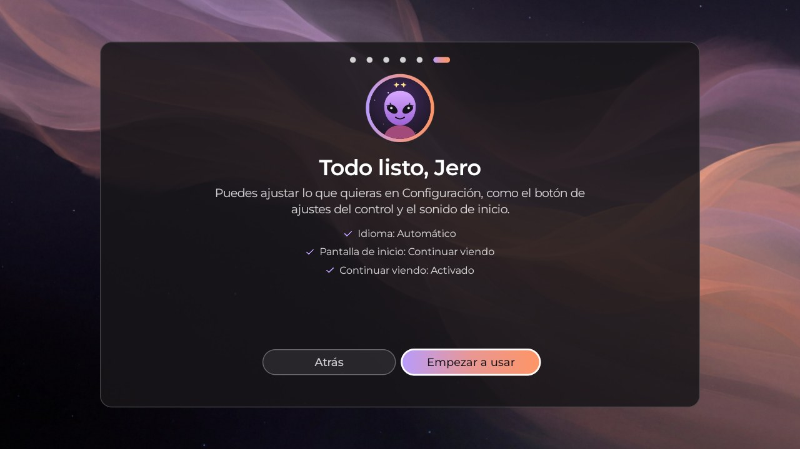 All set</td></tr>
</table>

## What it does
- A calm home screen with your apps, a shelf you can arrange, the weather and the time.
- **Your shelf, your way**: hold **OK** on a shelf app to *move*, *remove* or *hide* it. Hidden apps wait at the end of *All apps*, where you can bring them back.
- **Quiet when you want**: turn the click sounds off in Settings.
- **Updates inside the app**: a bell tells you when a new version is out, and *What's new* explains each change.
- **Continue watching**: pick up what you left half-watched in your apps, or discover movies and shows (TMDB).
- A screensaver and wallpapers, a welcome that sets everything up in a minute, and your own avatar.
- Fast on modest TVs: it is drawn directly, no heavy libraries.
- No accounts, no ads, no tracking: see [PRIVACY.md](PRIVACY.md).

## Install (about 10 minutes, one time)
Download `Borealis.apk` from [Releases](../../releases), or on the TV open **Downloader** and type the code **3357424**. Step by step in [INSTALL.md](INSTALL.md). In short: turn on USB debugging on the TV, then from a computer run
`adb connect <TV-IP>:5555` and `adb install Borealis.apk`, and open Borealis.

**Updates without technical steps:** after the first install, Borealis tells you when a new version is out. Choose *Settings → System → Updates*, press **Install** and accept: no computer, no extra app.

You can go back any time: in Borealis's settings choose **Original** and the TV's own home screen returns.

> **Before uninstalling Borealis, give the TV its own home screen back:** open Borealis → Settings → **Launcher** → **Original** and wait until it says it is done. Only then uninstall. In Borealis mode the TV's own launcher and some apps are turned off to make it fast; if you uninstall first, they stay off and the TV can get stuck at the startup logo.

**USB debugging is recommended.** With it, Borealis becomes your home screen for real. If your TV does not allow it (the port is closed, or the *Allow USB debugging?* question never appears), Borealis switches to **Plan B** (experimental, no computer): in Settings → Accessibility turn on Borealis and the Home button opens it; press Home twice quickly to open the TV's own home screen.

## Compatibility
Reports from real TVs (Android TV / Google TV):

| TV | Android | Result |
|---|---|---|
| Challenger (Realtek) | 11 | Full mode |
| Sansui 60" | 9 | Full mode |
| TCL 50Q6K | 14 | Full mode (installed with Downloader, debugging on) |
| Onn 4K Streaming Box | 14 | Plan B (the Wi-Fi blocks changing the home screen) |
| Other TCL / Hisense TVs | 11 | Being tested, reports welcome |

**Why it differs between TVs.** Every brand puts its own firmware on top of Android, and some let Borealis use the TV's debugging (ADB) while others do not. Borealis works in two ways:
- **Full mode** (the TV allows it): Borealis becomes your home screen and turns off the original launcher and some apps, so it is faster.
- **Plan B** (the TV does not allow it): Borealis opens with the Home button. For that it uses an accessibility permission that **only watches the Home and Settings keys**. It does not read your screen or content, and it is not TalkBack.

Untested: Fire TV, VIDAA, webOS and Tizen are not supported yet. Tell us in an [issue](../../issues) which TV you have and what you saw.

## Troubleshooting
- **"Allow USB debugging?" never appears.** On the TV: Developer options → *Revoke USB debugging authorizations*, then open Borealis again. If it still does not appear, Borealis switches to Plan B by itself.
- **The Wi-Fi disappears when changing the home screen.** Some TVs delete the Wi-Fi networks saved by their setup app when it is turned off. Borealis detects this and keeps the original launcher on (Plan B) so you do not lose the connection.
- **Can't turn Borealis on in Accessibility (Android 13/14).** Settings → Apps → Borealis → ⋮ → *Allow restricted settings*.
- **The TV is stuck on the logo after uninstalling Borealis.** The launcher that Borealis turned off is still off. If you can reach Settings → Apps → *See all apps*, find the TV's launcher (on Google TV it is usually *Google TV* or *Android TV Home*) and choose **Enable**. From a computer: `adb shell pm list packages -d` shows what is off, and `adb shell pm enable <package>` turns it back on. If you cannot get in, tell us your TV model in an [issue](../../issues).
- More in [INSTALL.md](INSTALL.md) and the [CHANGELOG](CHANGELOG.md).

## Build it yourself
Needs a JDK 17+ and the Android SDK command-line tools (build-tools 34+, platform android-34).

    ./build.sh

The first build creates `config.properties` (your city and an optional free TMDB key) and `borealis.keystore` +
`borealis.keystore.pass` (your signing key and its password: keep copies outside this folder, updates must use the same key).

## Maintenance and support
Borealis is maintained by its author. Expect updates over time: fixes, small improvements and support for new TVs
(LG webOS and Samsung Tizen are planned). It is a personal project, so there are no guarantees and no fixed dates.
Found a problem? Open an [issue](../../issues) and say which TV you have.

## Support the project
Borealis is free to install and use, and always will be. If you like it, you can support its development with a
voluntary donation through the **Sponsor** button at the top of this page (GitHub Sponsors). A donation does not
unlock anything: it only helps the work continue. Thank you!

## License
Free for noncommercial use under the [PolyForm Noncommercial License 1.0.0](LICENSE). Commercial use belongs to the
author. The name, logo, avatars and sound are not covered; see [NOTICE.md](NOTICE.md). Based on
[Free My TV](https://github.com/simbasjungles/free-my-tv) (MIT, kept in [LICENSE-FreeMyTV](LICENSE-FreeMyTV)).

GitHub may show "MIT licenses found" because the original Free My TV code keeps its MIT license. Borealis's own work is under PolyForm Noncommercial.

---

# Borealis TV Launcher (Español)

**Una pantalla de inicio ligera y bonita para Google TV y Android TV.** Tus apps, tu protector de pantalla y
"Continuar viendo", en tu idioma. Diseñado y desarrollado por **Alogus Tov**.

**[⬇ Descarga la última versión](../../releases/latest)** · o en la TV abre **Downloader** y escribe **3357424**

> Beta. Probado en Android TV 9, 11 y 14 (TCL, Sansui, Onn y otras), mira [Compatibilidad](#compatibilidad). Úsalo con cuidado y cuéntame qué encuentras.

<table>
  <tr>
    <td width="50%"> Configuración</td>
    <td width="50%"> Fondos de pantalla</td>
  </tr>
  <tr>
    <td width="50%"> Protector de pantalla</td>
    <td width="50%"> Elige tu avatar</td>
  </tr>
</table>

## Tu estante
<table>
  <tr>
    <td width="50%"> Mantén OK: mover o quitar del estante</td>
    <td width="50%"> Muévela con las flechas</td>
  </tr>
  <tr>
    <td width="50%"> Apps ocultas: vuelve a mostrarlas cuando quieras</td>
    <td width="50%"> Una campana te avisa de las actualizaciones</td>
  </tr>
</table>

## La primera vez
Una bienvenida de un minuto configura tu idioma, tu nombre, tu pantalla de inicio y "Continuar viendo". Puedes repetirla cuando quieras desde Configuración.

<table>
  <tr><td width="33%"> Bienvenida</td><td width="33%"> Idioma</td><td width="33%"> Tu nombre</td></tr>
  <tr><td width="33%"> Tu pantalla de inicio</td><td width="33%"> Continuar viendo</td><td width="33%"> Personaliza tu estante</td></tr>
  <tr><td width="33%"> Todo listo</td></tr>
</table>

## Qué hace
- Una pantalla de inicio tranquila con tus apps, un estante que organizas, el clima y la hora.
- **Tu estante, a tu manera**: mantén **OK** sobre una app del estante para *moverla*, *quitarla* u *ocultarla*. Las apps ocultas quedan al final de *Todas las apps*, y desde ahí las puedes mostrar de nuevo.
- **Silencio cuando quieras**: apaga el sonido de los clics en Ajustes.
- **Actualizaciones dentro de la app**: una campana te avisa cuando hay una versión nueva, y *Novedades* te cuenta cada cambio.
- **Continuar viendo**: retoma lo que dejaste a medias en tus apps, o descubre películas y series (TMDB).
- Protector de pantalla y fondos, una bienvenida que lo configura todo en un minuto, y tu propio avatar.
- Rápido en TVs modestas: se dibuja directamente, sin librerías pesadas.
- Sin cuentas, sin anuncios, sin rastreo: mira [PRIVACY.md](PRIVACY.md).

## Instalación (unos 10 minutos, una sola vez)
Descarga `Borealis.apk` desde [Releases](../../releases), o en la TV abre **Downloader** y escribe el código **3357424**. Paso a paso en [INSTALL.md](INSTALL.md). En resumen: activa la depuración USB en la TV; desde un computador ejecuta
`adb connect <IP-de-la-TV>:5555` y `adb install Borealis.apk`, y abre Borealis.

**Actualizaciones sin pasos técnicos:** después de la primera instalación, Borealis te avisa cuando hay una versión nueva. Elige *Configuración → Sistema → Actualizaciones*, pulsa **Instalar** y acepta: sin computador y sin otra app.

Puedes volver atrás cuando quieras: en los ajustes de Borealis elige **Original** y vuelve el inicio de tu TV.

> **Antes de desinstalar Borealis, devuelve a la TV su propio inicio:** abre Borealis → Ajustes → **Launcher** → **Original** y espera a que diga que terminó. Solo entonces desinstala. En el modo Borealis se apagan el launcher de la TV y algunas apps para que todo sea rápido; si desinstalas antes, se quedan apagados y la TV puede quedarse en el logo de arranque.

**La depuración USB es lo recomendado.** Con ella, Borealis se vuelve tu pantalla de inicio de verdad. Si tu TV no la permite (el puerto está cerrado o nunca aparece la pregunta *¿Permitir depuración USB?*), Borealis pasa al **Plan B** (experimental, sin computador): en Ajustes → Accesibilidad activa Borealis y el botón Inicio lo abre; presiona Inicio dos veces rápido para abrir el inicio propio de la TV.

## Compatibilidad
Reportes de TVs reales (Android TV / Google TV):

| TV | Android | Resultado |
|---|---|---|
| Challenger (Realtek) | 11 | Modo completo |
| Sansui 60" | 9 | Modo completo |
| TCL 50Q6K | 14 | Modo completo (instalada con Downloader, depuración activa) |
| Onn 4K Streaming Box | 14 | Plan B (el Wi-Fi bloquea el cambio de inicio) |
| Otras TCL / Hisense | 11 | En pruebas, se agradecen reportes |

**Por qué cambia entre TVs.** Cada marca pone su propio firmware sobre Android, y algunas dejan que Borealis use la depuración (ADB) de la TV y otras no. Borealis funciona de dos maneras:
- **Modo completo** (si la TV lo permite): Borealis se vuelve tu pantalla de inicio y apaga el launcher original y algunas apps, así que es más rápido.
- **Plan B** (si la TV no lo permite): Borealis se abre con el botón Inicio. Para eso usa un permiso de accesibilidad que **solo detecta las teclas Inicio y Ajustes**. No lee tu pantalla ni tu contenido, y no es TalkBack.

Sin soporte todavía: Fire TV, VIDAA, webOS y Tizen. Cuéntanos en un [issue](../../issues) qué TV tienes y qué viste.

## Problemas comunes
- **Nunca aparece "¿Permitir depuración USB?".** En la TV: Opciones para desarrolladores → *Revocar autorizaciones de depuración USB* y abre Borealis de nuevo. Si sigue sin aparecer, Borealis pasa solo al Plan B.
- **El Wi-Fi desaparece al cambiar el inicio.** Algunas TVs borran las redes Wi-Fi guardadas por su app de configuración cuando se apaga. Borealis lo detecta y deja encendido el launcher original (Plan B) para que no pierdas la conexión.
- **No puedo activar Borealis en Accesibilidad (Android 13/14).** Ajustes → Aplicaciones → Borealis → ⋮ → *Permitir ajustes restringidos*.
- **La TV se queda en el logo después de desinstalar Borealis.** El launcher que Borealis apagó sigue apagado. Si puedes entrar a Ajustes → Aplicaciones → *Ver todas las apps*, busca el launcher de la TV (en Google TV suele ser *Google TV* o *Android TV Home*) y elige **Habilitar**. Desde un computador: `adb shell pm list packages -d` muestra lo que está apagado y `adb shell pm enable <paquete>` lo vuelve a encender. Si no puedes entrar, cuéntanos tu modelo de TV en un [issue](../../issues).
- Más en [INSTALL.md](INSTALL.md) y el [CHANGELOG](CHANGELOG.md).

## Mantenimiento y soporte
Borealis lo mantiene su autor. Espera actualizaciones con el tiempo: correcciones, pequeñas mejoras y soporte para
nuevas TVs (están planeadas LG webOS y Samsung Tizen). Es un proyecto personal, así que no hay garantías ni fechas
fijas. ¿Encontraste un problema? Abre un [issue](../../issues) e indica qué TV tienes.

## Apoyar el proyecto
Borealis es gratis de instalar y usar, y lo seguirá siendo. Si te gusta, puedes apoyar su desarrollo con una donación
voluntaria desde el botón **Sponsor** en la parte superior de esta página (GitHub Sponsors). Donar no desbloquea nada:
solo ayuda a que el trabajo continúe. ¡Gracias!

## Licencia
Gratis para uso no comercial bajo la [PolyForm Noncommercial License 1.0.0](LICENSE). El uso comercial pertenece al
autor. El nombre, el logo, los avatares y el sonido no están cubiertos; mira [NOTICE.md](NOTICE.md). Basado en
[Free My TV](https://github.com/simbasjungles/free-my-tv) (MIT, en [LICENSE-FreeMyTV](LICENSE-FreeMyTV)).

GitHub puede mostrar "MIT licenses found" porque el código original de Free My TV conserva su licencia MIT. El trabajo propio de Borealis está bajo PolyForm Noncommercial.
